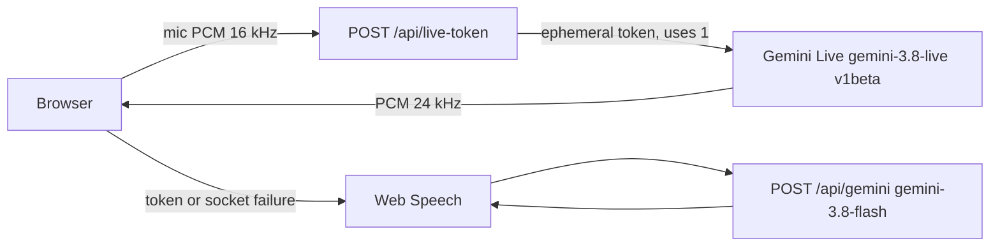

# AgriInsight AI

A Vite + React assistant for farmers. Voice is the home screen. Gemini stays on the server. The browser only receives a short-lived Live token.



If Live cannot connect, or low bandwidth is on, the app uses Web Speech for dictation and `/api/gemini` for the reply, then `speechSynthesis` to speak. Typed chat uses `/api/gemini` only.

## Environment

| Name | Required | What it does |
| --- | --- | --- |
| `GEMINI_API_KEY` | Yes, for model calls | Server only. Never prefix with `VITE_`. |
| `UPSTASH_REDIS_REST_URL` and `UPSTASH_REDIS_REST_TOKEN` | No | `POST /api/farm` mirrors the device profile. |
| `SUPABASE_URL` and `SUPABASE_SERVICE_ROLE_KEY` | No | Used only when Upstash is unset. Needs a `farm_profiles` table. |
| `PHONE_CALL_ENABLED` | No | Exact string `true`, plus `TWILIO_ACCOUNT_SID`, returns a TwiML string. It does not open a media stream. |
| `WHATSAPP_SUMMARY_ENABLED` | No | Exact string `true`. `POST /api/notify` logs and returns `sent: false`. |

Copy `.env.example` to `.env.local`. The Vite dev server reads it for `/api/*`.

The Live token allows one new session (`uses: 1`), 60 seconds to open the socket, and 10 minutes to keep sending. The in-memory rate limit is best-effort: each serverless isolate has its own counter.

## Run

```bash
npm install
npm run dev
```

Open http://localhost:3000. `npm test` runs Vitest. `npx tsc --noEmit` typechecks.

## What each step covers

1. **Server Gemini.** `POST /api/gemini` for chat, streaming chat, and disease. The key is not in the client bundle. Tailwind is built, not loaded from a CDN.
2. **Shell language.** Header, sidebar, chat errors, and voice errors use English and Hindi. Telugu, Tamil, Marathi, and Punjabi are listed and disabled. Feature screens still use their own copy.
3. **Tools.** Weather is Open-Meteo. Market, irrigation, soil, and yield are formulas and show a Demo data badge. Disease adds dose units and a KVK line when a chemical is named.
4. **Fallback voice.** Web Speech, streaming text, and speech synthesis, with a push-to-talk and hands-free session.
5. **Gemini Live.** `POST /api/live-token`, then `ai.live.connect` to `gemini-3.8-live` on `v1beta`. Input is 16 kHz PCM. Output is 24 kHz PCM. Server voice activity detection stays on. The interrupt button stops playback and sends `sendClientContent({ turnComplete: true })`.
6. **Farm memory.** Profile, notes, and reminders live in `localStorage`. `POST /api/farm` syncs only when Upstash or Supabase env vars exist. The morning briefing is a button, not a cron job. Reminders notify only while the page is open.
7. **Leaf camera.** “Check my leaf” or “check my crop” opens a shutter. The photo is scaled down, then sent to the disease tool. “Why this advice?” shows the inputs, source, and confidence.
8. **Field use.** Manifest, production service worker for the app shell and last advice, offline banner, low bandwidth, high contrast, large text, speech-rate slider, and 56px targets. The favicon is `/favicon.svg`.
9. **Optional channels.** Phone and WhatsApp stay off. “Hey Kisan” is off and is only stripped from text the fallback recognizer already heard. It does not listen in the background.
10. **This page and `DEMO.md`.**

## How to test

- Voice home loads in English. The mic asks for permission. If Live is out of quota, the status falls back to the speech service. That service is Chrome’s recognizer, not Gemini.
- Settings → Low bandwidth, then speak. The request should go to `/api/gemini`, not the Live socket.
- Market, irrigation, soil, and yield show **Demo data**. Weather and weather alerts call Open-Meteo and do not show that badge.
- Say “check my leaf”, take a photo, and read the disease card, including the KVK line when a chemical is mentioned.
- Play my morning briefing. It speaks with the speech-rate slider even when Live is down.
- Say “Hindi mein bolo” and confirm the header and voice status switch.
- Toggle high contrast, large text, and airplane mode. The offline banner keeps the last advice.
- `curl -s -X POST http://localhost:3000/api/farm` returns `{"synced":false}` unless a mirror is configured.
- `curl -s -X POST http://localhost:3000/api/twilio/voice` and `curl -s -X POST http://localhost:3000/api/notify -H 'content-type: application/json' -d '{}'` describe the disabled channels.

`ERR_BLOCKED_BY_CLIENT` in the console comes from a browser extension, often on the font request. It is not an application error. `/favicon.ico` is intentionally unused; the icon is `/favicon.svg`.
